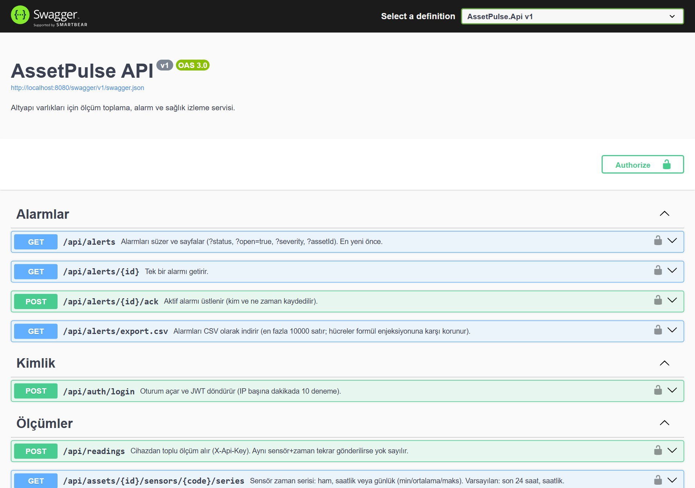
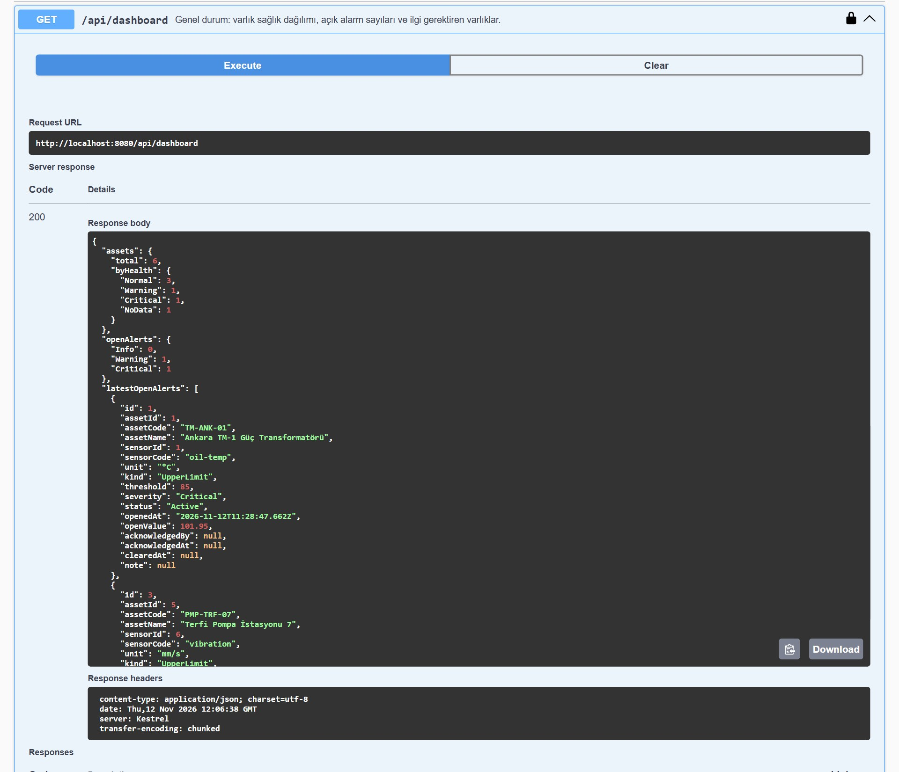
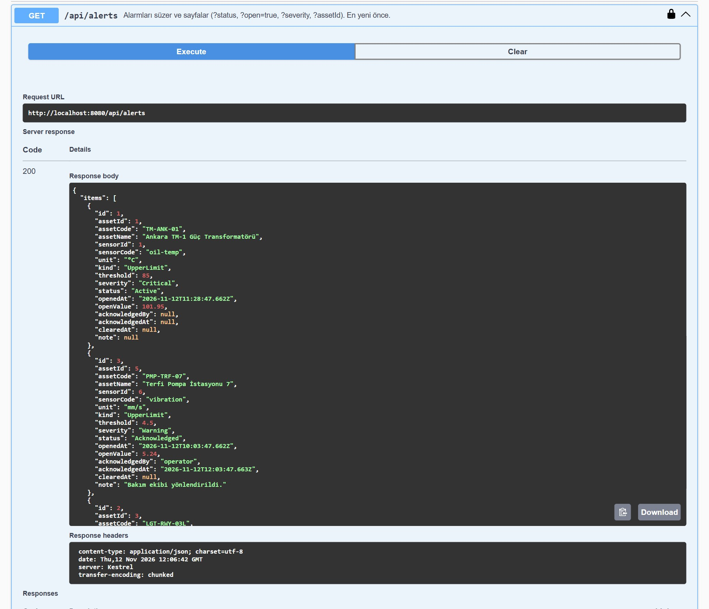
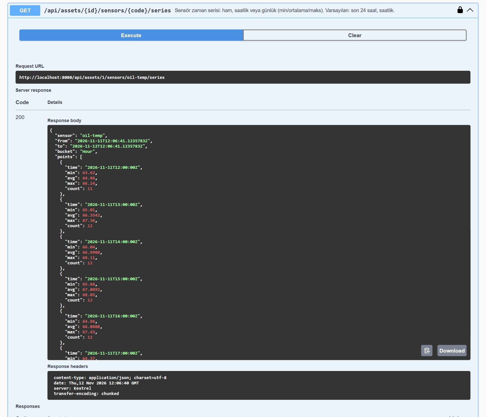

# AssetPulse – Altyapı Varlık İzleme ve Alarm Servisi


> **English summary:** A C# / ASP.NET Core 8 service that collects sensor readings from field assets (transformers, runway lighting regulators, signalling cabinets, pumps, generators), evaluates threshold rules with debouncing and hysteresis, manages the alert lifecycle (active → acknowledged → cleared) and reports asset health. Dapper + hand-written T-SQL on SQL Server, DbUp migrations, JWT roles for operators, API keys for devices, idempotent batch ingestion. 37 tests (unit + integration against a real SQL Server) run in CI.

Trafo merkezi, pist ışıklandırma regülatörü, sinyal panosu, pompa istasyonu ve jeneratör gibi saha varlıklarından gelen sensör ölçümlerini toplar; eşik kurallarına göre alarm üretir, alarmın yaşam döngüsünü (aktif → üstlenildi → kapandı) yönetir ve her varlığın sağlık durumunu gösterir.

## Ne işe yarar?

Saha cihazları (veri toplayıcı, SCADA ağ geçidi, basit bir betik) ölçümleri toplu olarak `POST /api/readings` ile gönderir. Servis ölçümleri saklar, alarm kurallarını değerlendirir ve operatörlerin kullandığı uç noktalar üzerinden şunları sunar:

- Hangi varlıklar **Kritik / Uyarı / Veri yok / Normal**?
- Hangi alarmlar açık, kim üstlendi, ne zaman kapandı?
- Bir sensörün son 24 saati veya son ayı (ham, saatlik ya da günlük min/ortalama/maks).
- Alarm geçmişinin CSV dökümü.

## Öne çıkan tasarım kararları

| Konu | Karar | Neden |
|---|---|---|
| **Veri erişimi** | Dapper + elle yazılmış T-SQL (ORM yok) | Sorgular görünür ve ayarlanabilir; `OUTER APPLY`, `OFFSET/FETCH`, `DATEADD/DATEDIFF` ile kovalama doğrudan SQL'de |
| **Şema yönetimi** | DbUp, gömülü `Migrations/*.sql` betikleri | Sürümlü, tekrar çalıştırılabilir; uygulama açılışta veritabanını kendisi oluşturur/günceller |
| **Alarm motoru** | Saf fonksiyon (`RuleEngine`), veritabanından bağımsız | Birim testlerle tek tek doğrulanır |
| **Gürültü bastırma** | *Art arda ihlal sayısı* + *histerezis* | Anlık dalgalanma alarm üretmez; eşik civarında alarm açılıp kapanıp durmaz |
| **Tekrarlanan veri** | `(SensorId, MeasuredAt)` birincil anahtar + `INSERT … WHERE NOT EXISTS` | Cihaz aynı ölçümü yeniden gönderirse (ağ kesintisi sonrası) hiçbir şey bozulmaz |
| **Geç gelen veri** | Saklanır ama alarm değerlendirmesine girmez | Sırası bozuk ölçüm alarm durumunu geriye sarmasın |
| **Eşzamanlılık** | Alımda sensör satırında `UPDLOCK`; "kural başına tek açık alarm" için *filtered unique index* | Aynı sensöre paralel istekler tutarsız alarm üretemez; veritabanı da kuralı garanti eder |
| **Kimlik** | Operatörler için JWT (Admin/Operator rolü), cihazlar için varlığa özel API anahtarı | Cihaz anahtarı yalnızca ölçüm yazabilir; veritabanında yalnızca SHA-256 özeti tutulur |

## Mimari

```
Saha cihazı ──X-Api-Key──▶ POST /api/readings ─┐
                                                ▼
                                        IngestionService  (tek işlem)
                                   doğrula → kaydet → RuleEngine → alarm aç/kapat
                                                │
Operatör ──JWT──▶ /api/assets, /api/alerts, /api/dashboard, …
                                                ▼
                            Dapper ──▶ SQL Server (Assets, Sensors, Readings, AlertRules, Alerts, Users)
```

```
src/AssetPulse.Api
├── Domain/        Modeller ve saf alarm motoru (RuleEngine)
├── Data/          Dapper erişim sınıfları, DbUp göçleri, satır tipleri
├── Services/      Toplu ölçüm alımı (IngestionService), açılış tohumlaması
├── Security/      API anahtarı üretimi/özeti, JWT üretimi
├── Endpoints/     Minimal API uç noktaları (kimlik, varlık, ölçüm, alarm, panel)
└── Migrations/    001_init.sql …
tests/AssetPulse.Tests   xUnit: birim + gerçek SQL Server'a karşı entegrasyon
```

## API

| Yöntem | Yol | Yetki | Açıklama |
|---|---|---|---|
| POST | `/api/auth/login` | – | JWT alır (IP başına dakikada 10 deneme) |
| POST | `/api/assets` | Admin | Varlık oluşturur, cihaz API anahtarını **bir kez** gösterir |
| GET | `/api/assets?health=Critical` | Giriş | Varlıklar ve sağlık durumları |
| GET | `/api/assets/{id}` | Giriş | Sensörler, son değerler, kurallar |
| POST | `/api/assets/{id}/sensors` | Admin | Sensör ekler |
| POST | `/api/sensors/{id}/rules` | Admin | Alarm kuralı (üst/alt sınır, histerezis, art arda sayı, önem) |
| POST | `/api/assets/{id}/rotate-key` | Admin | Cihaz anahtarını yeniler |
| POST | `/api/readings` | `X-Api-Key` | Toplu ölçüm alımı (en fazla 1000) |
| GET | `/api/assets/{id}/sensors/{code}/series` | Giriş | Ham / saatlik / günlük zaman serisi |
| GET | `/api/alerts` | Giriş | Süzme (`status`, `open`, `severity`, `assetId`) ve sayfalama |
| POST | `/api/alerts/{id}/ack` | Giriş | Alarmı üstlenir (kim, ne zaman, not) |
| GET | `/api/alerts/export.csv` | Giriş | CSV dökümü |
| GET | `/api/dashboard` | Giriş | Sağlık dağılımı, açık alarmlar, ilgi gerektirenler |
| GET | `/health`, `/health/ready` | – | Canlılık / veritabanı hazırlığı |

## Çalıştırma

Gereksinim: Docker.

```bash
cp .env.example .env     # değerleri kendi parolalarınızla değiştirin
docker compose up --build
```

API `http://localhost:8080` adresinde, Swagger arayüzü `/swagger` altında açılır. `SEED_DEMO_DATA=true` ise ilk açılışta boş veritabanına 6 varlık ve 48 saatlik sentetik ölçüm yüklenir (bir aktif kritik alarm, bir üstlenilmiş alarm, bir kapanmış alarm ve ölçüm göndermeyen bir varlık içerir). Bu veri gerçek bir sahadan gelmez; paneli ve alarm akışını göstermek için üretilir.

Kullanıcılar `admin` ve `operator`; parolaları `.env` dosyasındaki `ADMIN_PASSWORD` ve `OPERATOR_PASSWORD` değerleridir.

Örnek akış:

```bash
TOKEN=$(curl -s localhost:8080/api/auth/login -H 'Content-Type: application/json' \
  -d '{"username":"admin","password":"<ADMIN_PASSWORD>"}' | jq -r .token)

# Varlık oluştur (yanıttaki apiKey yalnızca şimdi görünür)
curl -s localhost:8080/api/assets -H "Authorization: Bearer $TOKEN" -H 'Content-Type: application/json' \
  -d '{"code":"TM-ANK-09","name":"Deneme Trafosu","category":"Transformer"}'

# Sensör ve alarm kuralı: 3 art arda ölçüm 85 °C üstündeyse Kritik alarm
curl -s localhost:8080/api/assets/<id>/sensors -H "Authorization: Bearer $TOKEN" -H 'Content-Type: application/json' \
  -d '{"code":"oil-temp","name":"Yağ sıcaklığı","unit":"°C"}'
curl -s localhost:8080/api/sensors/<sensorId>/rules -H "Authorization: Bearer $TOKEN" -H 'Content-Type: application/json' \
  -d '{"kind":"UpperLimit","threshold":85,"hysteresis":3,"consecutiveCount":3,"severity":"Critical"}'

# Cihaz tarafı: ölçüm gönder
curl -s localhost:8080/api/readings -H 'X-Api-Key: <apiKey>' -H 'Content-Type: application/json' \
  -d '{"readings":[{"sensor":"oil-temp","measuredAt":"2026-11-12T10:00:00Z","value":71.4}]}'
```

Yapılandırma ortam değişkenleriyle yapılır: `ConnectionStrings__Default`, `Jwt__Secret` (en az 32 karakter), `Seed__AdminPassword`, `Seed__OperatorPassword`, `Seed__DemoData`, `AssetPulse__StaleAfterMinutes` (varsayılan 30), `Swagger__Enabled`, `Database__MigrateOnStartup`. Gizli değerler repoda tutulmaz; eksikse uygulama başlamaz.

## Test ve CI

```bash
dotnet test      # SQL Server testleri için ASSETPULSE_TEST_SQL tanımlı olmalı; yoksa yalnızca birim testleri çalışır
```

37 test: alarm motoru (eşik sınırları, art arda sayı, histerezis, alt/üst sınır), sağlık önceliği, API anahtarı, CSV kaçışı ve gerçek SQL Server'a karşı uçtan uca senaryolar (yetkilendirme, çift kayıt, geçersiz/geç/gelecek ölçüm, alarm yaşam döngüsü, üstlenme çakışması, saatlik özet, anahtar yenileme, CSV). Entegrasyon testleri her çalıştırmada kendi geçici veritabanını oluşturur ve siler. GitHub Actions bir SQL Server servisiyle tüm testleri çalıştırır ve Docker imajının derlendiğini doğrular.

## Ekran Görüntüleri

Demo verisiyle çalışan uygulamanın Swagger arayüzü:









## Güvenlik notları ve bilinen sınırlar

- Parolalar ASP.NET Core `PasswordHasher` (PBKDF2) ile saklanır; giriş zamanlaması kullanıcının varlığını sızdırmaz; `/login` hız sınırlıdır. Cihaz anahtarları 192 bit rastgeledir, yalnızca özeti saklanır.
- CSV çıktısında hücreler formül enjeksiyonuna karşı kaçışlanır; SQL parametreliyken kova ifadeleri sabit bir listeden seçilir.
- Docker Compose örneği kolaylık için `sa` hesabını kullanır; üretimde yalnızca bu veritabanına yetkili ayrı bir hesap kullanılmalıdır.
- Hız sınırlayıcı bellektedir (tek örnek); ters vekil arkasında istemci IP'si için `ForwardedHeaders` ayarlanmalıdır.
- Bildirim (e-posta/SMS), ölçüm saklama süresi (retention) ve token yenileme yoktur; tek örnek olarak çalışacak biçimde tasarlanmıştır.
- Ölçümler tek işlemde satır satır yazılır (istek başına en fazla 1000); çok yüksek hacimde toplu yazma (`SqlBulkCopy`/tablo tipli parametre) sonraki adımdır.

---
*Geliştirici: Emircan Kılıçaslan*
