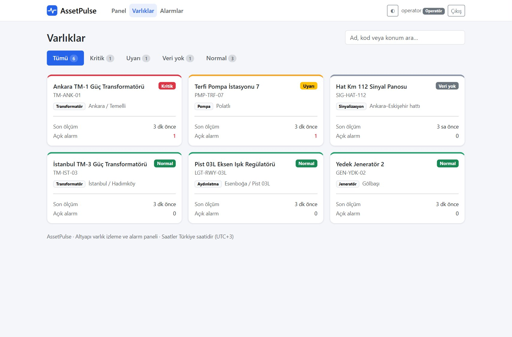
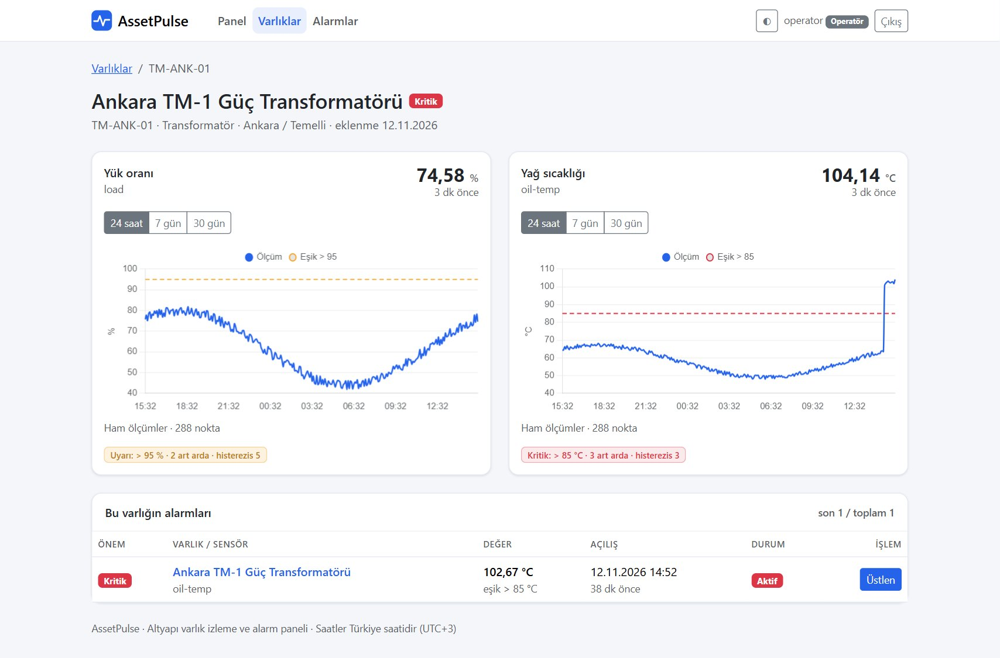
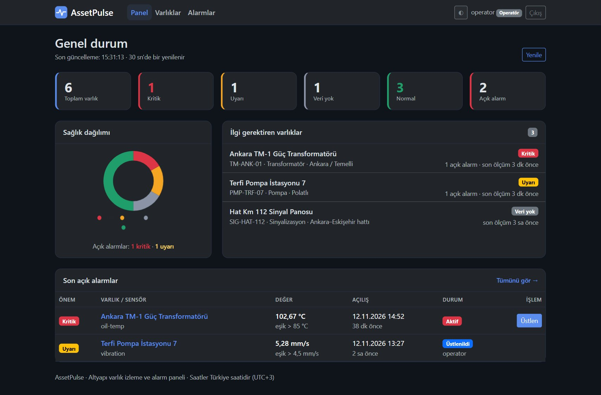
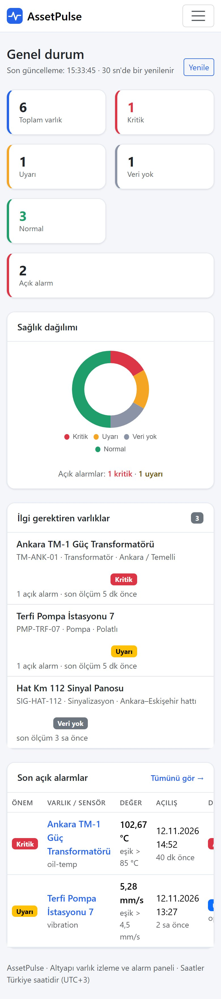

# AssetPulse – Altyapı Varlık İzleme ve Alarm Platformu

 

> **English summary:** A C# / ASP.NET Core 8 platform that collects sensor readings from field assets (transformers, runway lighting regulators, signalling cabinets, pumps, generators), evaluates threshold rules with debouncing and hysteresis, manages the alert lifecycle (active → acknowledged → cleared) and reports asset health. It ships as two apps: a REST API (Dapper + hand-written T-SQL on SQL Server, DbUp migrations, JWT roles, device API keys, idempotent batch ingestion) and a server-rendered ASP.NET Core MVC (Razor) operator panel (Bootstrap 5, Chart.js, dark mode, CSRF protection, strict CSP) that talks to the API only over HTTP. 67 tests (unit, integration against a real SQL Server, and UI tests against a fake API) run in CI.

Trafo merkezi, pist ışıklandırma regülatörü, sinyal panosu, pompa istasyonu ve jeneratör gibi saha varlıklarından gelen sensör ölçümlerini toplar; eşik kurallarına göre alarm üretir, alarmın yaşam döngüsünü (aktif → üstlenildi → kapandı) yönetir ve her varlığın sağlık durumunu operatör panelinde gösterir.


## Ne işe yarar?

Saha cihazları (veri toplayıcı, SCADA ağ geçidi, basit bir betik) ölçümleri toplu olarak `POST /api/readings` ile gönderir. Platform ölçümleri saklar, alarm kurallarını değerlendirir ve operatörlere şunları sunar:

- Hangi varlıklar **Kritik / Uyarı / Veri yok / Normal**? (panel, sağlık dağılımı, ilgi gerektirenler)
- Hangi alarmlar açık, kim üstlendi, ne zaman kapandı? (süzme, sayfalama, üstlenme notu, CSV)
- Bir sensörün son 24 saati, 7 günü ya da 30 günü; eşik çizgisiyle birlikte (ham ölçüm, saatlik min/ortalama/maks).
- Admin için: varlık, sensör ve alarm kuralı tanımlama; cihaz anahtarı üretme/yenileme.

## İki uygulama, tek solution

| Proje | Teknoloji | Görev |
|---|---|---|
| `src/AssetPulse.Api` | ASP.NET Core 8 Minimal API, Dapper, T-SQL, DbUp, JWT | Ölçüm alımı, alarm motoru, REST uç noktaları |
| `src/AssetPulse.Web` | ASP.NET Core 8 MVC (Razor), Bootstrap 5, Chart.js | Operatör paneli. Veritabanına dokunmaz; yalnızca API'yi çağırır |
| `tests/AssetPulse.Tests` | xUnit, gerçek SQL Server | Alarm motoru ve API uçtan uca testleri |
| `tests/AssetPulse.Web.Tests` | xUnit, `WebApplicationFactory`, sahte API | Giriş, yetki, CSRF, yönlendirme, hata sayfaları |

Panel ile API arasındaki ilişki kasıtlı olarak sadedir: panel, kullanıcının JWT'sini şifreli kimlik çerezinde saklar ve her API çağrısına `Authorization: Bearer` olarak ekler. Böylece API tek doğruluk kaynağı kalır; başka bir arayüz (mobil, Angular vb.) aynı API'yi kullanabilir.

## Operatör paneli

| | |
|---|---|
|  |  |
|  |  |

- **Panel:** sağlık kartları, halka grafik, ilgi gerektiren varlıklar, son açık alarmlar; 30 saniyede bir kendini yeniler (açık pencere varken yenilemez, yazılan not kaybolmaz).
- **Varlıklar:** sağlık sekmeleri ve anlık arama.
- **Varlık detayı:** sensör başına son değer, 24 saat / 7 gün / 30 gün grafiği, eşik çizgileri, kural özetleri ve varlığın alarm geçmişi.
- **Alarmlar:** durum ve önem süzgeci, sayfalama, "Üstlen" penceresi (not ile), CSV indirme.
- **Admin:** yeni varlık (API anahtarı yalnızca bir kez gösterilir), sensör ve kural ekleme, anahtar yenileme. Operatör bu sayfalara giremez.
- **Açık/koyu tema**, mobil uyumlu düzen (dar ekranda yatay taşma yok; aşağıda telefon görünümü), Türkçe arayüz ve Türkiye saati (UTC+3).
- **Bootstrap ve Chart.js projeye gömülüdür** (`wwwroot/lib`, sürümler aşağıda); internet erişimi kısıtlı kurum ağlarında CDN'e ihtiyaç duymaz.



## Öne çıkan tasarım kararları

| Konu | Karar | Neden |
|---|---|---|
| **Veri erişimi** | Dapper + elle yazılmış T-SQL (ORM yok) | Sorgular görünür ve ayarlanabilir; `OUTER APPLY`, `OFFSET/FETCH`, `DATEADD/DATEDIFF` ile kovalama doğrudan SQL'de |
| **Şema yönetimi** | DbUp, gömülü `Migrations/*.sql` betikleri | Sürümlü, tekrar çalıştırılabilir; uygulama açılışta veritabanını kendisi oluşturur/günceller |
| **Alarm motoru** | Saf fonksiyon (`RuleEngine`), veritabanından bağımsız | Birim testlerle tek tek doğrulanır |
| **Gürültü bastırma** | *Art arda ihlal sayısı* + *histerezis* | Anlık dalgalanma alarm üretmez; eşik civarında alarm açılıp kapanıp durmaz |
| **Tekrarlanan veri** | `(SensorId, MeasuredAt)` birincil anahtar + `INSERT … WHERE NOT EXISTS` | Cihaz aynı ölçümü yeniden gönderirse (ağ kesintisi sonrası) hiçbir şey bozulmaz |
| **Zaman damgası hassasiyeti** | Dapper `DateTime` parametreleri açıkça `datetime2` gönderilir | Varsayılan `datetime` 3,33 ms'ye yuvarlar; yinelenen kayıt denetimi bozulurdu (testle korunuyor) |
| **Geç gelen veri** | Saklanır ama alarm değerlendirmesine girmez | Sırası bozuk ölçüm alarm durumunu geriye sarmasın |
| **Eşzamanlılık** | Alımda sensör satırında `UPDLOCK`; "kural başına tek açık alarm" için *filtered unique index* | Aynı sensöre paralel istekler tutarsız alarm üretemez; veritabanı da kuralı garanti eder |
| **Kimlik** | Operatörler için JWT (Admin/Operator), cihazlar için varlığa özel API anahtarı | Cihaz anahtarı yalnızca ölçüm yazabilir; veritabanında yalnızca SHA-256 özeti tutulur |
| **Arayüz güvenliği** | Çerez kimliği (HttpOnly), tüm POST'larda antiforgery, sıkı CSP (`script-src 'self'`, inline betik/stil yok), `X-Frame-Options: DENY` | Tipik web saldırılarına (CSRF, XSS, clickjacking) karşı varsayılan koruma |

## Mimari

```
Saha cihazı ──X-Api-Key──▶ POST /api/readings ─┐
                                                ▼
                                        IngestionService  (tek işlem)
                                   doğrula → kaydet → RuleEngine → alarm aç/kapat
                                                │
Tarayıcı ──çerez──▶ AssetPulse.Web ──Bearer JWT──▶ AssetPulse.Api ──Dapper──▶ SQL Server
 (Razor + Chart.js)   (MVC, ApiClient)              (/api/assets, /api/alerts, …)
```

```
src/AssetPulse.Api
├── Domain/        Modeller ve saf alarm motoru (RuleEngine)
├── Data/          Dapper erişim sınıfları, DbUp göçleri, satır tipleri
├── Services/      Toplu ölçüm alımı (IngestionService), açılış tohumlaması
├── Security/      API anahtarı üretimi/özeti, JWT üretimi
├── Endpoints/     Minimal API uç noktaları (kimlik, varlık, ölçüm, alarm, panel)
└── Migrations/    001_init.sql …
src/AssetPulse.Web
├── Api/           Türlü API istemcisi (ApiClient) ve yanıt modelleri
├── Controllers/   Account, Home, Assets, Alerts
├── Views/         Razor görünümleri ve ortak parçalar (alarm tablosu, üstlenme penceresi)
├── Helpers/       Türkçe etiketler, tarih/sayı biçimleri
├── Infrastructure/ API hatalarını kullanıcı dostu sonuçlara çeviren filtre
└── wwwroot/       css, js, gömülü Bootstrap ve Chart.js
```

## API

| Yöntem | Yol | Yetki | Açıklama |
|---|---|---|---|
| POST | `/api/auth/login` | – | JWT alır (IP başına dakikada 10 deneme) |
| POST | `/api/assets` | Admin | Varlık oluşturur, cihaz API anahtarını **bir kez** gösterir |
| GET | `/api/assets?health=Critical` | Giriş | Varlıklar ve sağlık durumları |
| GET | `/api/assets/{id}` | Giriş | Sensörler, son değerler, kurallar |
| POST | `/api/assets/{id}/sensors` | Admin | Sensör ekler |
| POST | `/api/sensors/{id}/rules` | Admin | Alarm kuralı (üst/alt sınır, histerezis, art arda sayı, önem) |
| POST | `/api/assets/{id}/rotate-key` | Admin | Cihaz anahtarını yeniler |
| POST | `/api/readings` | `X-Api-Key` | Toplu ölçüm alımı (en fazla 1000) |
| GET | `/api/assets/{id}/sensors/{code}/series` | Giriş | Ham / saatlik / günlük zaman serisi |
| GET | `/api/alerts` | Giriş | Süzme (`status`, `open`, `severity`, `assetId`) ve sayfalama |
| POST | `/api/alerts/{id}/ack` | Giriş | Alarmı üstlenir (kim, ne zaman, not) |
| GET | `/api/alerts/export.csv` | Giriş | CSV dökümü |
| GET | `/api/dashboard` | Giriş | Sağlık dağılımı, açık alarmlar, ilgi gerektirenler |
| GET | `/health`, `/health/ready` | – | Canlılık / veritabanı hazırlığı |

Swagger arayüzü `/swagger` altındadır:


## Çalıştırma

Gereksinim: Docker.

```bash
cp .env.example .env     # değerleri kendi parolalarınızla değiştirin
docker compose up --build
```

| Adres | İçerik |
|---|---|
| `http://localhost:8081` | Operatör paneli |
| `http://localhost:8080/swagger` | API ve Swagger arayüzü |

`SEED_DEMO_DATA=true` ise ilk açılışta boş veritabanına 6 varlık ve 48 saatlik sentetik ölçüm yüklenir (bir aktif kritik alarm, bir üstlenilmiş alarm, bir kapanmış alarm ve ölçüm göndermeyen bir varlık içerir). Bu veri gerçek bir sahadan gelmez; paneli ve alarm akışını göstermek için üretilir. Ölçümler sabit bir tarihte üretildiği için yarım saat sonra alarmı olmayan varlıklar "Veri yok" görünür; yeni ölçüm göndererek (aşağıdaki örnek) canlı akış denenebilir.

Kullanıcılar `admin` ve `operator`; parolaları `.env` dosyasındaki `ADMIN_PASSWORD` ve `OPERATOR_PASSWORD` değerleridir.

Örnek akış (API):

```bash
TOKEN=$(curl -s localhost:8080/api/auth/login -H 'Content-Type: application/json' \
  -d '{"username":"admin","password":"<ADMIN_PASSWORD>"}' | jq -r .token)

# Varlık oluştur (yanıttaki apiKey yalnızca şimdi görünür)
curl -s localhost:8080/api/assets -H "Authorization: Bearer $TOKEN" -H 'Content-Type: application/json' \
  -d '{"code":"TM-ANK-09","name":"Deneme Trafosu","category":"Transformer"}'

# Sensör ve alarm kuralı: 3 art arda ölçüm 85 °C üstündeyse Kritik alarm
curl -s localhost:8080/api/assets/<id>/sensors -H "Authorization: Bearer $TOKEN" -H 'Content-Type: application/json' \
  -d '{"code":"oil-temp","name":"Yağ sıcaklığı","unit":"°C"}'
curl -s localhost:8080/api/sensors/<sensorId>/rules -H "Authorization: Bearer $TOKEN" -H 'Content-Type: application/json' \
  -d '{"kind":"UpperLimit","threshold":85,"hysteresis":3,"consecutiveCount":3,"severity":"Critical"}'

# Cihaz tarafı: ölçüm gönder
curl -s localhost:8080/api/readings -H 'X-Api-Key: <apiKey>' -H 'Content-Type: application/json' \
  -d '{"readings":[{"sensor":"oil-temp","measuredAt":"2026-11-12T10:00:00Z","value":71.4}]}'
```

Yapılandırma ortam değişkenleriyle yapılır.

| Uygulama | Değişkenler |
|---|---|
| API | `ConnectionStrings__Default`, `Jwt__Secret` (en az 32 karakter), `Seed__AdminPassword`, `Seed__OperatorPassword`, `Seed__DemoData`, `AssetPulse__StaleAfterMinutes` (varsayılan 30), `Swagger__Enabled`, `Database__MigrateOnStartup` |
| Web | `Api__BaseUrl` (zorunlu), `Display__UtcOffsetHours` (varsayılan 3), `Auth__SecureCookie` (HTTPS arkasında `true`) |

Gizli değerler repoda tutulmaz; eksikse API başlamaz.

## Test ve CI

```bash
dotnet test      # SQL Server testleri için ASSETPULSE_TEST_SQL tanımlı olmalı; yoksa onlar atlanır
```

67 test:

- **Alarm motoru ve API (37):** eşik sınırları, art arda sayı, histerezis, sağlık önceliği, API anahtarı, CSV kaçışı ve gerçek SQL Server'a karşı uçtan uca senaryolar (yetkilendirme, çift kayıt, geçersiz/geç/gelecek ölçüm, milisaniye hassasiyeti, alarm yaşam döngüsü, üstlenme çakışması, saatlik özet, anahtar yenileme, CSV). Entegrasyon testleri her çalıştırmada kendi geçici veritabanını oluşturur ve siler.
- **Arayüz (30):** gerçek HTTP hattı (çerez, antiforgery, yetki filtreleri) üzerinde, API'nin yerine konan sahte bir sunucuyla: girişsiz erişim, yanlış parola, açık yönlendirme (open redirect) engeli, token'ın API'ye iletilmesi, süresi dolan oturum, API'ye ulaşılamaması (503 sayfası), rol kısıtı, API anahtarının yalnızca bir kez gösterilmesi, alarm üstlenme, güvenlik başlıkları ve Türkçe biçimlendirme yardımcıları.

GitHub Actions bir SQL Server servisiyle tüm testleri çalıştırır ve iki Docker imajının da derlendiğini doğrular.

## Güvenlik notları ve bilinen sınırlar

- Parolalar ASP.NET Core `PasswordHasher` (PBKDF2) ile saklanır; giriş zamanlaması kullanıcının varlığını sızdırmaz; hem API hem panel `/login` istekleri hız sınırlıdır. Cihaz anahtarları 192 bit rastgeledir, yalnızca özeti saklanır.
- Panel, JWT'yi tarayıcı JavaScript'inin erişemediği şifreli çerezde tutar; formlarda antiforgery doğrulanır; içerik güvenlik politikası inline betiğe izin vermez.
- Panel API'ye tek bir sunucu IP'sinden bağlandığı için API'nin IP başına giriş sınırı panel kullanıcıları arasında paylaşılır (dakikada 10 deneme).
- CSV çıktısında hücreler formül enjeksiyonuna karşı kaçışlanır; SQL parametreliyken kova ifadeleri sabit bir listeden seçilir.
- Docker Compose örneği kolaylık için `sa` hesabını kullanır ve HTTP üzerinde çalışır; üretimde ayrı bir veritabanı hesabı, HTTPS ve `Auth__SecureCookie=true` kullanılmalıdır. Çerez şifreleme anahtarları kalıcı değildir: panel yeniden başlayınca oturumlar kapanır.
- Hız sınırlayıcılar bellektedir (tek örnek); ters vekil arkasında istemci IP'si için `ForwardedHeaders` ayarlanmalıdır.
- Bildirim (e-posta/SMS), ölçüm saklama süresi (retention) ve token yenileme yoktur; tek örnek olarak çalışacak biçimde tasarlanmıştır.
- Ölçümler tek işlemde satır satır yazılır (istek başına en fazla 1000); çok yüksek hacimde toplu yazma (`SqlBulkCopy`/tablo tipli parametre) sonraki adımdır.

## Üçüncü taraf bileşenler

Arayüze gömülü dosyalar (MIT lisanslı, resmî paketlerden alınmış, sürümleri sabit): **Bootstrap 5.3.3** ve **Chart.js 4.4.4** (`src/AssetPulse.Web/wwwroot/lib`). Diğer bağımlılıklar NuGet üzerinden gelir (Dapper, DbUp, Serilog, Swashbuckle).

---
*Geliştirici: Emircan Kılıçaslan*

## Lisans

Bu proje [MIT Lisansı](LICENSE) ile paylaşılmaktadır.
